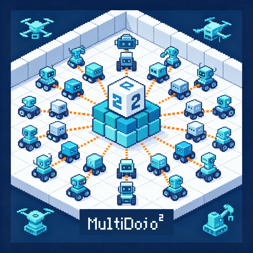
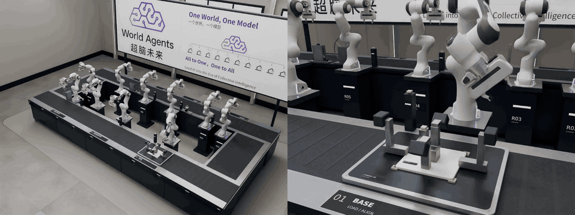
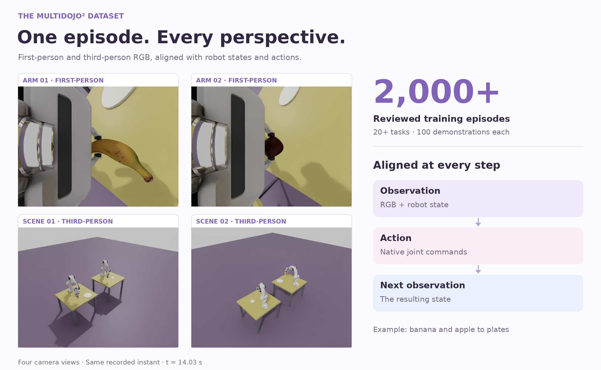
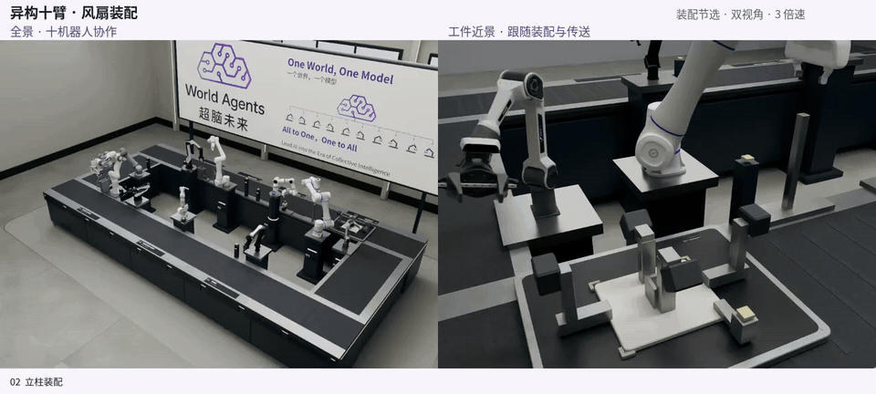
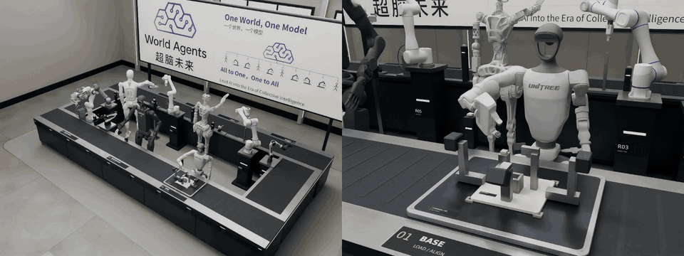
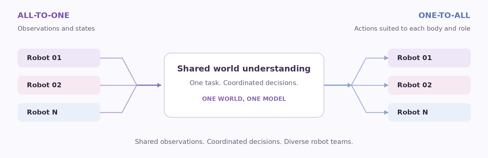
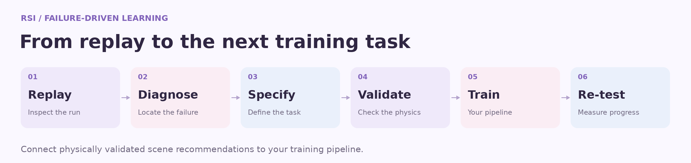
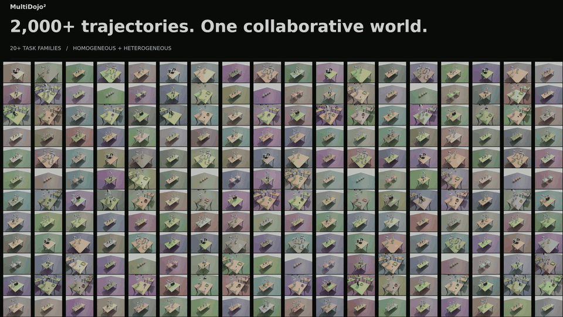

<p align="center"></p>

<h1 align="center">RoboDojo²</h1>

<p align="center"><strong>The World's First Self-Evolving Leaderboard for Heterogeneous Multi-Robot Collaboration</strong></p>

<p align="center"><strong>English</strong> · <a href="README.zh-CN.md" lang="zh-CN">简体中文</a></p>

<p align="center"><a href="index.en.html">Project website</a> · <a href="#dataset">Dataset</a> · <a href="#tasks">Tasks</a> · <a href="#evaluation">Evaluation</a> · <a href="#rsi">RSI</a> · <a href="#quick-start">Get started</a></p>

| Training demonstrations | Task families | Robot teams | RSI |
| :---: | :---: | :---: | :---: |
| **2,000+** | **20+** · 100 demos each | **2 / 3 / 4 / 8 arms** | **Learn & Evolve** |

## Collaboration in action

[](assets/fan-isomorphic.mp4)

<p align="center"><a href="assets/fan-isomorphic.mp4">▶ Watch ten-arm fan assembly</a> · <a href="assets/collaboration-overview.mp4">Watch the collection overview</a></p>

Ten matching arms share an assembly sequence, transferring a workpiece between stations and coordinating each step toward a completed fan.

## Dataset

**A balanced collection of 2,000+ reviewed simulation demonstrations across 20+ collaborative manipulation tasks.** Each task contributes 100 episodes, covering handovers, relays, shared transport, ordered stacking, and parallel manipulation.

[](assets/dataset-perspectives.png)

- **See the team and the local interaction.** Every arm has a first-person view, accompanied by third-person views of the shared workspace. Follow grasping details and inter-robot coordination on the same timeline.
- **Learn from aligned observations and actions.** RGB, robot state, native joint commands, next observations, and camera calibration preserve the connection between what each robot sees and how it moves.
- **Study collaboration across robot designs.** Homogeneous and heterogeneous teams span two, three, four, and eight arms. Native joint orders, units, and actuator masks retain each robot's control semantics.
- **Explore meaningful scene variation.** Object and goal positions, workspaces, and scene appearance vary while preserving the task's manipulation objective.
- **Use physically reviewed episodes.** Acceptance checks cover grasping and contact, object support, placement stability, arm-to-arm collision constraints, synchronized images, and file integrity.

**[Download the yellow-tabletop subset on Hugging Face →](https://huggingface.co/datasets/WorldAgents-c/RoboDojo2-YellowTabletops)**

The first public data release contains **301 complete demonstrations across all 20 task families**, with synchronized first-person and third-person views, native states/actions, and acceptance records. It selects yellow and warm-yellow tabletops from the collection; per-task subset counts and loading instructions are provided in the dataset repository.

[Data format & loader example →](PROJECT.md#dataset) · [Machine-readable task catalog →](assets/task-catalog.json)

<br>

## Collaboration across embodiments

### Heterogeneous robot teams

[](assets/fan-heterogeneous.mp4)

Different manipulators take complementary roles in the same assembly workflow, coordinating transfers and operations around a shared workpiece.

<p align="center"><a href="assets/fan-heterogeneous.mp4">▶ Watch heterogeneous fan assembly</a></p>

<br>

### Humanoids and manipulators

[](assets/fan-humanoid.mp4)

Humanoids and robot arms extend the collaboration across body types, working together through the assembly sequence.

<p align="center"><a href="assets/fan-humanoid.mp4">▶ Watch humanoid–manipulator collaboration</a></p>

*Fan assembly and humanoid–manipulator collaboration extend the research showcases beyond the manipulation task suite.*

## All-to-One. One-to-All.

**Robot automation scales through collaboration.** Shared tasks call for a shared understanding of the workspace, coordinated timing, and actions suited to each robot's role.

**All-to-One** brings observations and states into a common view of the world. **One-to-All** turns that shared understanding into coordinated actions across different robots. **One World, One Model** expresses the research vision behind this approach.



## Tasks

The suite spans **five collaboration skills**: handover, relay, shared lifting, stacking, and parallel manipulation. Each task includes **100 training demonstrations**, with evaluation designed around varied scene conditions and initial states.

| ID | Task | Team | Skill |
| --- | --- | --- | --- |
| 00 | Banana handover into a pan | Homogeneous · 2 arms | Handover |
| 01 | Banana and apple to plates | Homogeneous · 2 arms | Parallel manipulation |
| 02 | Collaborative carton transport | Homogeneous · 2 arms | Shared lifting |
| 03 | Two-stage cup relay | Homogeneous · 2 arms | Relay |
| 04 | Place and stack blocks | Homogeneous · 2 arms | Stacking |
| 05 | Franka–Piper long-block handover | Heterogeneous · 2 arms | Handover |
| 06 | Three-arm block relay | Homogeneous · 3 arms | Relay |
| 07 | Apples to baskets | Homogeneous · 4 arms | Parallel manipulation |
| 08 | Four-arm block relay | Homogeneous · 4 arms | Relay |
| 09 | Ordered four-color stacking | Homogeneous · 4 arms | Stacking |
| 10 | Cookies to boxes | Homogeneous · 4 arms | Parallel manipulation |
| 11 | Household objects to boxes | Homogeneous · 4 arms | Parallel manipulation |
| 12 | Eight-arm blocks to boxes | Homogeneous · 8 arms | Parallel manipulation |
| 13 | Three-arm block relay | Heterogeneous · 3 arms | Relay |
| 14 | Four-arm block relay | Heterogeneous · 4 arms | Relay |
| 15 | Eight-arm blocks to boxes | Heterogeneous · 8 arms | Parallel manipulation |
| 16 | Three-arm banana relay | Heterogeneous · 3 arms | Relay |
| 17 | Three-arm white-cup relay | Heterogeneous · 3 arms | Relay |
| 18 | Four-arm banana relay | Heterogeneous · 4 arms | Relay |
| 19 | Four-arm white-cup relay | Heterogeneous · 4 arms | Relay |

<details>
<summary>Canonical task identifiers</summary>
<pre>00  BananaDualArmHandover
01  IsomorphicDualArm/BananaAppleToPlates
02  IsomorphicDualArm/CollabLiftLongBox
03  IsomorphicDualArm/CupLeftToMidToRight
04  IsomorphicDualArm/LeftPlaceRightStack
05  HeterogeneousDualArm/FrankPiperBananaHandover
06  IsomorphicTripleArm/BlockZoneRelay
07  IsomorphicQuadArm/AppleToBasket
08  IsomorphicQuadArm/BlockZoneRelay
09  IsomorphicQuadArm/ColorBlockCenterStack
10  IsomorphicQuadArm/CookieToBox
11  IsomorphicQuadArm/HouseholdToBox
12  IsomorphicOctaArm/BlocksToBoxes
13  HeterogeneousTripleArm/BlockZoneRelay
14  HeterogeneousQuadArm/BlockZoneRelay
15  HeterogeneousOctaArm/BlocksToBoxes
16  HeterogeneousTripleArm/BananaZoneRelay
17  HeterogeneousTripleArm/WhiteCupZoneRelay
18  HeterogeneousQuadArm/BananaZoneRelay
19  HeterogeneousQuadArm/WhiteCupZoneRelay</pre>
</details>

The [task catalog](assets/task-catalog.json) connects IDs **00–19** with task names, camera sets, and episode ranges in the training index. [Task and identifier guide →](PROJECT.md#task-ids)

## Evaluation

**Test collaboration under controlled scene variation.** Evaluation varies object and goal positions, permitted appearance, and initial states while preserving task instructions and physical requirements.

```text
Task success rate = successful trials / evaluated trials
Overall score = 100 × mean(task success rate across evaluated task families)
```

Success combines task completion with the required grasp, transfer order, support, destination, stability, and collision constraints. Equal weighting across task families makes results easy to compare, while recorded execution evidence supports reproducibility and review.

**Online evaluation is coming soon.**

[Evaluation protocol & policy integration →](PROJECT.md#evaluation)

## RSI

**Turn replay evidence into a focused training objective.** RSI connects execution records with failure explanations and concrete follow-up tasks, helping researchers decide what a policy should practise next.

[](assets/rsi-workflow.png)

A training recommendation specifies the participating robots, object, initial and goal ranges, collaboration order, motion constraints, and success conditions. Candidate scenes pass native physical validation before entering training; re-evaluation measures the effect of the next training round.

Use the [RSI workflow guide](PROJECT.md#rsi) to connect scene recommendations to your training pipeline. [RSI interface guide / 中文 →](RSI-USER.zh.md)

## Quick start

Preview the project with **Python 3.10+**:

```sh
python3 scripts/check_release.py
python3 -m http.server 8000 --bind 127.0.0.1 --directory .
```

Open [localhost:8000](http://localhost:8000/), then explore the dataset, task catalog, and evaluation guide.

[Research & usage guide](PROJECT.md) · [Related work](RELATED_WORK.md) · [Deployment guide](PROJECT.md#deployment)

For questions or contributions, include the task ID, episode or trial ID, and the steps needed to reproduce the issue.

Website code and documentation: [MIT License](LICENSE) · [Attribution](NOTICE.md).

<br>

<a id="one-collection-thousands-of-collaborative-moments"></a>

<a id="2000-trajectories-in-motion"></a>

## 2,000+ trajectories in motion

[](assets/trajectory-wall.mp4)

<p align="center"><a href="assets/trajectory-wall.mp4">▶ Explore the full collection · 4K · 54 seconds</a></p>

From dual-arm handovers to eight-arm workstations: a continuously scrolling panorama of collaborative manipulation, accompanied by assembly showcases.
